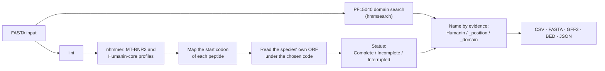

<div align="center">

# HumaninFinder

**Homology-based location and annotation of Humanin and SHLP1-6 in mitogenomes, contigs and nuclear assemblies**

[](https://github.com/LaBiOmicS/humaninfinder/actions/workflows/tests.yml)
[](https://pypi.org/project/humanin-finder/)
[](pyproject.toml)
[](LICENSE)
[](#project-status)

[Website](https://labiomics.github.io/humaninfinder/) •
[Run in the browser](https://labiomics.github.io/humaninfinder/app/) •
[Installation](#installation) •
[Quick start](#quick-start) •
[Usage](#usage) •
[Method](#method) •
[Outputs](#outputs) •
[Limitations](#limitations) •
[Citation](#citation)

</div>

---

## Overview

Humanin and the six **small humanin-like peptides (SHLP1-6)** are mitochondrial-derived peptides
encoded by short open reading frames inside the 16S rRNA gene, `MT-RNR2`. Because they overlap a
structural RNA, ordinary gene finders miss them, and because `MT-RNR2` has many nuclear copies
(NUMTs), a sequence match alone does not tell where a copy comes from or whether its frame is intact.

HumaninFinder locates each peptide by its **position in MT-RNR2**, using profile HMMs of the gene built
from vertebrate mitogenomes of several clades, and then reads **the species' own reading frame** at that
position. Every reported frame states which evidence supports it and how far that evidence goes.

> [!IMPORTANT]
> All evidence produced by HumaninFinder is **in silico homology**. A reported frame is a candidate:
> HumaninFinder makes no claim that a peptide is transcribed, translated or functional.

### Features

- **Position first.** Peptides are located by their homologous position in `MT-RNR2` (`nhmmer`
  against whole-gene and Humanin-core profiles), not by matching the human peptide sequence, so
  divergent orthologues are still found.
- **Species' own frame.** The ORF is read from the local start codon, under the genetic code you
  choose, and classified as `Complete`, `Incomplete` or `Interrupted`.
- **Graded evidence.** Names tell how far the evidence goes (`Humanin`, `Humanin_position`,
  `Humanin_domain`), and the Pfam domain PF15040 is reported as independent support.
- **Mitogenomes and NUMTs.** `predict` returns the best frame per record; `scan` returns every locus,
  for contigs and chromosomes carrying nuclear copies.
- **Circular genomes.** Loci that cross the origin of a circular mitogenome are read through it and
  written with the GFF3 convention for circular sequences.
- **Standard outputs.** CSV, FASTA, GFF3 and BED, plus a JSON provenance record with the command,
  the options and the SHA-256 of the input.
- **No external binaries.** HMMER runs in memory through [pyhmmer](https://github.com/althonos/pyhmmer);
  every profile ships with the package.

### Peptides

Reference peptides on the revised Cambridge Reference Sequence (rCRS, NC_012920.1), as reported by
HumaninFinder on the bundled example. Coordinates are 1-based and include the stop codon.

| Peptide | Strand | rCRS coordinates | Code | Length | Sequence | Literature tier¹ |
|---|:-:|---|:-:|:-:|---|:-:|
| Humanin | + | 2633-2698 | 2 | 21 aa | `MAPRGFSCLLLLTSEIDLPVK` | — |
| SHLP1 | − | 2485-2559 | 1 | 24 aa | `MCHWAGGASNTGDARGDVFGKQAG` | E3 |
| SHLP2 | − | 2088-2168 | 1 | 26 aa | `MGVKFFTLSTRFFPSVQRAVPLWTNS` | E4 |
| SHLP3 | − | 1703-1819 | 1 | 38 aa | `MLGYNFSSFPCGTISIAPGFNFYRLYFIWVNGLAKVVW` | E4 |
| SHLP4 | − | 2442-2522 | 1 | 26 aa | `MLEVMFLVNRRGKICRVPFTFFNLSL` | E4 |
| SHLP5 | − | 2780-2854 | 1 | 24 aa | `MYCSEVGFCSEVAPTEIFNAGLVV` | E2 |
| SHLP6 | + | 2990-3052 | 1 | 20 aa | `MLDQDIPMVQPLLKVRLFND` | E4 |

¹ Cobb *et al.* 2016: E2 transcript detected, E3 peptide detected, E4 exogenous biological activity.
Humanin read under the cytosolic code (Table 1) gives the 24-aa form `MAPRGFSCLLLLTSEIDLPVKRRA`.

## Installation

HumaninFinder requires Python ≥ 3.10. Its dependencies are Biopython, click and pyhmmer.

**No installation: in the browser.** The [web version](https://labiomics.github.io/humaninfinder/app/)
runs the same code in your browser through [Pyodide](https://pyodide.org), with a WebAssembly build of
pyhmmer ([pyhmmer-pyodide](https://github.com/LaBiOmicS/pyhmmer-pyodide)). Sequences stay on your
computer. Its outputs are byte-identical to the installed tool's on the validation sets; it runs on one
thread and suits up to a few hundred mitogenomes per run.

**From PyPI**

```sh
pip install humanin-finder
```

**From Bioconda** (recipe under review in
[bioconda-recipes#71446](https://github.com/bioconda/bioconda-recipes/pull/71446))

```sh
conda install -c conda-forge -c bioconda humanin-finder
```

**From source**

```sh
git clone https://github.com/LaBiOmicS/humaninfinder.git
cd humaninfinder
pip install .
```

**From source, in a conda environment**

[`environment.yml`](environment.yml) creates an environment named `humaninfinder` with every
dependency from conda-forge and Bioconda, plus pytest and ruff, and installs the clone in editable mode:

```sh
git clone https://github.com/LaBiOmicS/humaninfinder.git
cd humaninfinder
micromamba env create -f environment.yml    # or: conda env create -f environment.yml
micromamba activate humaninfinder
```

Then check that the installation and every bundled data file are usable:

```console
$ humanin-finder setup
[*] Verifying HumaninFinder v1.0.0b3 prerequisites...
[+] pyhmmer (in-memory HMMER 0.12.3) verified.
[+] PF15040 Humanin domain: gathering threshold 27.0 bits.
[+] SHLP references: SHLP1, SHLP2, SHLP3, SHLP4, SHLP5, SHLP6.
[+] MT-RNR2 locus profiles: MT-RNR2 (1686 states, >= 140 bits), Humanin_core (211 states, >= 105 bits)
[+] Vertebrate-like density (Humanin vs Humanin_position): MT-RNR2 >= 0.587 bits/column

[!] Setup inspection complete: all bundled data files verified.
```

> [!NOTE]
> pyhmmer is pinned below its next minor version on purpose: it carries the semantics of the bundled
> profiles. Bounds are raised only after the test and validation suites pass against a new release.

The package installs two equivalent commands, `humanin-finder` and `humaninfinder`.

## Quick start

Run HumaninFinder on the human reference mitogenome bundled in `examples/`, under the vertebrate
mitochondrial code, treating the record as circular:

```console
$ humanin-finder predict -i examples/rcrs_nc_012920_1.fasta -o rcrs -g 2 --circular
-----------------------------------------------------------------------------------------------------
Sequence ID            | Peptide                | Status       | 1-Based Coords     | Locus bits | HMM Score
-----------------------------------------------------------------------------------------------------
NC_012920.1            | Humanin                | Complete     | 2633-2698          | 1341       | 57.2
NC_012920.1            | SHLP3                  | Complete     | 1703-1819          | 1341       | -
NC_012920.1            | SHLP2                  | Complete     | 2088-2168          | 1341       | -
NC_012920.1            | SHLP4                  | Complete     | 2442-2522          | 1341       | -
NC_012920.1            | SHLP1                  | Complete     | 2485-2559          | 1341       | -
NC_012920.1            | SHLP5                  | Complete     | 2780-2854          | 1341       | -
NC_012920.1            | SHLP6                  | Complete     | 2990-3052          | 1341       | -
```

This writes `rcrs_results.{csv,fasta,gff3,bed}` and `rcrs_run.json`: seven `Complete` frames, Humanin
and SHLP1-6, all at the vertebrate-like `MT-RNR2` locus.

```console
$ cat rcrs_results.fasta
>NC_012920.1|Humanin|Complete|coords_2633-2698|evidence_Synteny+HMM
MAPRGFSCLLLLTSEIDLPVK
>NC_012920.1|SHLP3|Complete|coords_1703-1819|evidence_Synteny
MLGYNFSSFPCGTISIAPGFNFYRLYFIWVNGLAKVVW
...
```

## Usage

### Commands

| Command | Use |
|---|---|
| `predict` | Best Humanin frame per genetic code, plus SHLP1-6, for each record. The usual choice for mitogenomes. |
| `scan` | Every non-redundant locus per record: mitochondrial and NUMT copies in contigs or chromosomes. |
| `lint` | Validate a FASTA file without changing it. |
| `setup` | Verify the installation and the bundled data files. |

Run `humanin-finder <command> --help` for the full list of options.

### Options of `predict` and `scan`

| Option | Description |
|---|---|
| `-i`, `--input FILE` | FASTA, plain or gzip-compressed. It is linted first; an invalid file stops the run. |
| `-o`, `--output TEXT` | Output prefix. |
| `-g`, `--table TEXT` | NCBI genetic code(s), e.g. `2` or `2,1`. Default `auto`: Table 2 for mitochondrial records (the header says *mitochondri*, or the record is ≤ 50 kb), Table 1 otherwise. |
| `--circular` | Treat records ≤ 50 kb as circular, so a locus crossing the origin is read through it. Longer records are always linear. |
| `--no-hmm` | Skip the PF15040 domain search. |
| `--no-rescue` | Skip the HMM-guided rescue of interrupted frames. |
| `--no-shlp` | Skip the SHLP1-6 annotation. |
| `--no-synteny` | Skip the `MT-RNR2` locus search (domain search only). |
| `--all-candidates` (`predict`) | Report every non-redundant candidate instead of the best one per code. |
| `--best-only` (`scan`) | Report only the best candidate per code (the default for `scan` is every candidate). |

> [!TIP]
> `auto` only covers vertebrates. For other mitogenomes pass the code explicitly, e.g. `-g 5` for
> insects or `-g 9` for echinoderms. A NUMT inside a short nuclear contig needs `-g 1`.

### Common recipes

```sh
# Complete mitogenomes (any assembly origin): read through the origin
humanin-finder predict -i mitogenomes.fasta -o mito -g 2 --circular

# Compare the mitochondrial and the cytosolic reading of the same loci
humanin-finder predict -i mitogenomes.fasta -o mito_t2t1 -g 2,1

# NUMTs: every MT-RNR2 copy in a nuclear assembly, read under the standard code
humanin-finder scan -i genome.fa.gz -o numts -g 1

# Non-vertebrate mitogenome, explicit code
humanin-finder predict -i drosophila_mt.fasta -o dmel -g 5 --circular

# Check a FASTA before a long run
humanin-finder lint genome.fa.gz
```

## Method



1. **Locus.** The record is searched with `nhmmer` against two profiles: the whole `MT-RNR2` gene and
   the Humanin core. Each profile hit at or above the profile's evidence threshold maps the start codon
   of every peptide. The threshold is calibrated above the paralogous bacterial and plastid 23S and the
   nuclear 28S rRNAs.
2. **Frame.** The species' own ORF is read from the start codon nearest the mapped one (within 6
   codons either way). Humanin is read under the requested code. SHLP1-6 are read under the cytosolic
   code (Table 1) in every record: SHLP1-4 give their published sequences only under it, and SHLP5-6,
   identical under Tables 1 and 2 in human, follow the family. Cobb *et al.* 2016 do not name a code;
   the reasoning is recorded in `shlp_references.json` (`translation_table_note`).
3. **Status.** Structure only, with no functional claim:

   | Status | Meaning |
   |---|---|
   | `Complete` | Start codon through an in-frame stop. The start is the species' own and may sit up to 6 codons from the human one (`start_offset_codons`), with any initiator of the code, so `Complete` does not mean that the human start codon is conserved. |
   | `Incomplete` | No start codon, or no stop within 60 codons. |
   | `Interrupted` | An in-frame stop inside the homologous span under the evaluated code. |

4. **Name.** How far the evidence goes:

   | Name | Evidence |
   |---|---|
   | `Humanin`, `SHLP<n>` | At a vertebrate-like `MT-RNR2` locus. For Humanin, the name is also given to a locus whose frame carries the PF15040 domain at the Pfam gathering threshold. |
   | `Humanin_position`, `SHLP<n>_position` | At an `MT-RNR2` locus outside the vertebrate pattern. Only the homologous position is marked. |
   | `Humanin_domain` | A PF15040 domain outside any `MT-RNR2` locus. Only the domain is supported. |

   With several codes (`-g 2,1`) names carry a suffix such as `_T2`.

A peptide can be absent from the table even though its locus is present: its start codon may fall in
a deletion or an assembly gap, leaving no frame to read. Those cases are listed in `<prefix>_gaps.csv`
and announced at the end of the run.

## Outputs

| File | Content |
|---|---|
| `<prefix>_results.csv` | One row per reported frame (columns below). |
| `<prefix>_results.fasta` | Peptides; header `sample\|name\|status\|coords_<start>-<end>\|evidence_<source>`. |
| `<prefix>_results.gff3` | `ORF` features, 1-based inclusive. Circular records get a `region` with `Is_circular=true`. |
| `<prefix>_results.bed` | 0-based half-open. A feature crossing the origin is split into two blocks with the same name. |
| `<prefix>_gaps.csv` | Peptides whose start codon aligns to a gap (written only when there are any). |
| `<prefix>_run.json` | Provenance: command, options, input SHA-256, version and row counts. |

<details>
<summary><b>Columns of <code>&lt;prefix&gt;_results.csv</code></b></summary>

| Group | Columns | Meaning |
|---|---|---|
| Identity | `sample_id`, `name`, `status`, `seq`, `length` | Record, peptide name, status, peptide sequence and length (aa). |
| Location | `strand`, `frame`, `start_0based`, `end_0based`, `start_1based`, `end_1based` | Half-open 0-based and inclusive 1-based coordinates; they include the stop codon of a `Complete` frame. |
| Circularity | `circular_wrap` | `True` when the feature crosses the origin; `end` then exceeds the record length (GFF3 convention). |
| `MT-RNR2` locus | `synteny_score`, `locus_profile`, `locus_density`, `locus_mode` | Bitscore of the locus profile, the profile that produced it, bits per aligned profile column, and how the frame was located. |
| PF15040 domain | `hmm_bitscore`, `hmm_evalue`, `hmm_supported` | Domain score; E-value of a single comparison (Z = 1), so the same domain gets the same value in a short or a long record; whether it reaches the gathering threshold. |
| Evidence | `evidence_source`, `evidence_tier`, `reference_evidence_tier` | `Synteny`, `HMM` or both; `E1` (in silico homology); the literature tier of the human peptide, given only for a `Complete` frame identical to it. |
| Comparison | `identity_to_reference` | Ungapped identity of the homologous span to the human peptide. Descriptive only; it does not enter the status. |
| Reading | `start_offset_codons`, `genetic_code`, `table_1_pep` | Local start relative to the mapped human start; the code used; the cytosolic reading of a Table 2 sORF that starts with a Table 1 initiator. |

</details>

### Evidence tiers

| Tier | Meaning | Where |
|---|---|---|
| E1 | In silico, homologous position conserved across clades | `evidence_tier`, every frame HumaninFinder reports |
| E2 | Transcript detected (RT-PCR, RNA-seq) | `reference_evidence_tier` (literature) |
| E3 | Peptide detected (antibody, mass spectrometry) | `reference_evidence_tier` (literature) |
| E4 | Exogenous biological activity shown (cell or animal assays) | `reference_evidence_tier` (literature) |

HumaninFinder never assigns more than E1 to a frame it finds. The literature tier describes the human
peptide and is copied only when the frame found is identical to it.

## Limitations

- **Homology only.** Evidence is the position in `MT-RNR2` and/or the PF15040 domain. Expression and
  function have to be shown experimentally.
- **Vertebrate profiles.** The profiles were built from vertebrate mitogenomes. Outside vertebrates a
  locus is named `_position` at most.
- **`auto` code.** It treats records ≤ 50 kb as mitochondrial and covers vertebrate codes only.
- **Origin and the domain search.** The PF15040 search itself is linear. A Humanin locus crossing the
  origin still gets its PF15040 score, computed from the peptide that was read.

## Project status

HumaninFinder **1.0.0b3** is a beta that accompanies a manuscript in preparation (1.0.0b1 was the first
tagged release; 1.0.0b2 added this documentation and fixed the rat record of the example set; 1.0.0b3
corrects the strand of SHLP6 in the documentation and adds the web version and `environment.yml`): the
command-line interface and output formats are expected to stay stable, but they may still change before
1.0.0. Changes are listed on the [releases page](https://github.com/LaBiOmicS/humaninfinder/releases).

## Development

```sh
git clone https://github.com/LaBiOmicS/humaninfinder.git
cd humaninfinder
pip install -e . pytest ruff     # or: micromamba env create -f environment.yml
ruff check src tests
pytest
```

Continuous integration runs the suite on Python 3.10, 3.11 and 3.12, and once more from the built
source distribution, which is how Bioconda and reviewers install the package.

```text
src/humanin_finder/
├── cli.py          # commands, options and output writers
├── core.py         # locus search, frame reading, status and naming
├── shlp.py         # SHLP1-6 annotation
├── fasta_lint.py   # FASTA validation
└── data/           # profile HMMs (MT-RNR2, Humanin core, PF15040) and reference tables
examples/           # rCRS reference mitogenome and a small test set
tests/              # unit and regression tests
recipe/             # Bioconda recipe
environment.yml     # conda environment for a clone
```

### Contributing

Bug reports and suggestions are welcome on the
[issue tracker](https://github.com/LaBiOmicS/humaninfinder/issues). For a wrong or missing call,
please attach the FASTA record (or its accession), the exact command and the `<prefix>_run.json` file.
Pull requests should keep `ruff check` and `pytest` passing and add a test for the behaviour they
change.

## Citation

If you use HumaninFinder, please cite the software version you ran. The accompanying article is in
preparation; this section will be updated when it is published. Machine-readable metadata are in
[`CITATION.cff`](CITATION.cff) (GitHub's "Cite this repository" button).

```bibtex
@software{humaninfinder,
  author  = {Menegidio, Fabiano Bezerra and {LaBiOmicS}},
  title   = {{HumaninFinder}: homology-first location and annotation of Humanin and SHLP1-6},
  version = {1.0.0b3},
  year    = {2026},
  url     = {https://github.com/LaBiOmicS/humaninfinder}
}
```

Please also cite the resources HumaninFinder builds on:

- Cobb LJ, Lee C, Xiao J, *et al.* Naturally occurring mitochondrial-derived peptides are
  age-dependent regulators of apoptosis, insulin sensitivity, and inflammatory markers.
  *Aging (Albany NY)* 2016;8(4):796-809. PMID: 27070352.
- Larralde M, Zeller G. PyHMMER: a Python library binding to HMMER for efficient sequence analysis.
  *Bioinformatics* 2023;39(5):btad214.
- Mistry J, *et al.* Pfam: The protein families database in 2021. *Nucleic Acids Res* 2021;49(D1):D412-D419.

## License

HumaninFinder is released under the [MIT License](LICENSE). The bundled PF15040 profile comes from
Pfam (CC0). The rCRS reference (NC_012920.1) is from NCBI RefSeq.

## Contact

Developed at **LaBiOmicS**, Universidade de Mogi das Cruzes (UMC), Brazil.
Maintainer: Prof. Dr. Fabiano Bezerra Menegidio. Questions and reports go through the
[issue tracker](https://github.com/LaBiOmicS/humaninfinder/issues).
